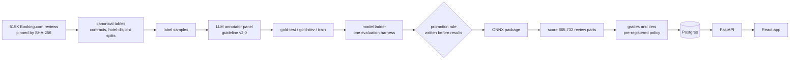

# hotel-curator

**Live site: [hotel-curator.fly.dev](https://hotel-curator.fly.dev)** (online
once the first deploy has run; see [Deploy](#deploy))

**Hotel quality tiers from guest reviews, with the evidence behind every
tier.** hotel-curator reads what guests wrote about 1,494 European city hotels
(515,212 Booking.com reviews, 2015-2017), works out which of eight things each
guest praised or complained about, and turns that into a tier per hotel
(Excellent, Good, Fair, Caution, or "not enough evidence") that you can check
by hand.

> In 30 seconds: a classifier labels every review part ("Liked: ...",
> "Disliked: ...") with praise or complaints about cleanliness, room, staff,
> location, noise, wifi, value and food. For each hotel those labels become
> counts, the counts become grades with stated certainty ("at least 4 praises
> per complaint, 95% sure"), and the grades of cleanliness, room and staff
> decide the tier. Every hotel page says why it got its tier, what would change
> it, and quotes reviews for and against.

## Results

All numbers come from committed artifacts; the commands that produced them
are in [Reproduce everything](#reproduce-everything).

| | v2 | v1 (prototype) |
|---|---|---|
| Review classifier, gold-test macro-F1 (1,200 reviews from 182 hotels no model saw; 95% interval) | **0.922** [0.911, 0.932] | 0.687 [0.668, 0.705] |
| Difference, paired over the same reviews | **+0.236** [+0.216, +0.255] | |
| Calibration (mean review-level ECE; lower is better) | 0.010 | 0.029 |
| Served model | roberta-base fine-tuned on 8,006 labelled reviews, ONNX int8, gold-test 0.920 | |
| Speed on 4 CPU threads | 224 review parts/s in a 20,000-part benchmark (about 1.1 hours for the corpus); the measured full run took 1.7 hours (5,987 s) | |

Tiers for the 1,494 hotels: **Good 58, Fair 960, Caution 271**, not enough
evidence 129, not enough reviews 76, **Excellent 0**. No hotel is Excellent:
Excellent needs cleanliness, room and staff all graded Strong, and Strong
means at least 95% certain that 80% or more of the guests' opinions on it are
praise. 64 hotels reach that for both cleanliness and staff, but none for the
room (the closest is 94.1% certain). Booking.com asks every guest what they
disliked, and the room collects most of those complaints. The lines were
fixed before any hotel was scored and were not moved after seeing this;
[TIERS.md](docs/model/TIERS.md) shows how the mix would change with other
lines. Grades from 2015-2016 predict what guests said
in 2017 (Spearman 0.43 to 0.72 per attribute), and in a simulation with the
model's real errors at most 2.8% of claims were false (target 5%).

How the model was chosen: [comparison](docs/model/COMPARISON.md),
[model card](artifacts/models/roberta-base-ft-train2/MODEL_CARD.md),
[error analysis](docs/model/ERRORS.md).

> **The trained model's weights (126 MB) are stored with Git LFS.** A clone
> made with Git LFS installed has them; otherwise install Git LFS and run
> `git lfs pull --include="artifacts/models/*/model.onnx"` (a plain
> `git lfs pull` also fetches the archived v1 checkpoint, 499 MB). Without
> them, search, hotel pages and compare still work from the committed
> results, and only "Try the model" (`POST /v1/analyze`) answers "model not
> loaded". The corpus part scores (`data/processed/part_scores.parquet`,
> 13 MB) are not committed, so re-running `make score-hotels` or
> `make validate-tiers` first needs `make data` and `make score-parts`
> (1.7 hours on 4 CPU threads).

## Try it

```bash
docker compose up --build        # then open http://localhost:8080
```

That starts Postgres, the API and the web app, and loads the committed
results for all hotels. The API docs are at
http://localhost:8000/docs.

### Building behind a proxy

If your network goes through a TLS-inspecting proxy, the image builds need
its CA certificate and proxy address. Pass the certificate as a build secret
(it never ends up in an image layer):

```bash
docker build --network host \
  --build-arg HTTPS_PROXY="$HTTPS_PROXY" \
  --secret id=extra_ca,src=/path/to/proxy-ca.pem \
  -t hotel-curator-api:local .
docker build --network host \
  --build-arg HTTPS_PROXY="$HTTPS_PROXY" \
  --secret id=extra_ca,src=/path/to/proxy-ca.pem \
  -t hotel-curator-web:local web
docker compose up --no-build
```

Without a proxy, skip this and use `docker compose up --build`.

Without Docker (Python 3.12, [uv](https://docs.astral.sh/uv/)):

```bash
make setup      # API, data and dev dependencies from uv.lock
make serve      # SQLite database + demo data, API on http://127.0.0.1:8000
cd web && npm ci && npm run dev   # web app on http://localhost:5173
```

## Deploy

The public site is meant to run at **https://hotel-curator.fly.dev**, and
later on its own domain behind Cloudflare. It is not live yet: the first
deploy needs the owner's Fly.io account ([BLOCKERS](docs/BLOCKERS.md) B9).
The API image carries the model weights from Git LFS, and every Fly build
checks them against the promotion record.

It runs as three Fly.io apps in `lhr`: the web app (nginx and the React
app, the only public one), the API (private, reached over Fly's private
network) and Postgres (private, TLS only). After the first deploy by hand,
every push to `main` that passes CI deploys once the owner has turned
deploys on and approves each one, then smoke-tests the public site.

```bash
make fly-plan                                  # print every command a first deploy runs
make fly-secrets                               # check .env.fly, stage it as Fly secrets
make fly-setup                                 # apps, database volume, the API's private address
make fly-deploy                                # database, API, web, in that order
make fly-status                                # machines; fails if the API or database is public
make smoke SMOKE_URL=https://hotel-curator.fly.dev
make fly-stop                                  # park the site; make fly-start resumes it
```

| You want to | Read |
|---|---|
| Deploy for the first time, handle secrets, redeploy, deploy from GitHub | [docs/deploy/fly.md](docs/deploy/fly.md) |
| Move the site behind Cloudflare, check it, roll back | [docs/deploy/cloudflare.md](docs/deploy/cloudflare.md) |
| Run it: status, parking, logs, metrics, alerts, incidents | [docs/RUNBOOK.md](docs/RUNBOOK.md) |
| Know why it is built this way, and what is still unverified on Fly | [ADR 011](docs/decisions/011-deployment-fly-cloudflare.md) |

## How it works



1. **Data** (`make data`): the Booking.com 515K Europe dataset is fetched from
   a pinned mirror, checked against SHA-256 hashes, cleaned into `hotels` and
   `reviews` tables with schema contracts, and split by hotel (no hotel is in
   two splits). [Data card](docs/data/DATA_CARD.md), [EDA](docs/data/EDA.md).
2. **Labels** (`make labels`): 9,800 reviews were labelled by a panel of LLM
   annotators following a written guideline; gold labels are the majority of
   three. Agreement with people was measured on an external human-labelled
   set. [Guideline](docs/labeling/GUIDELINES.md),
   [agreement](docs/labeling/AGREEMENT.md),
   [panel vs people](docs/labeling/EXTERNAL_CHECK.md).
3. **Models** (`make models`): TF-IDF baselines, frozen sentence embeddings,
   and three fine-tuned encoders, all scored by one harness on the same
   gold-test reviews, against the v1 model. A promotion rule written before
   any result decides what ships. [Comparison](docs/model/COMPARISON.md),
   [model card](artifacts/models/roberta-base-ft-train2/MODEL_CARD.md), [errors](docs/model/ERRORS.md).
4. **Tiers** (`make scores`): labels become per-hotel counts; Beta posteriors
   turn counts into grades only when a claim is at least 95% certain; the
   three essentials decide the tier. Every parameter was fixed before any
   hotel was scored. [Tier scheme](docs/decisions/006-tier-scheme.md),
   [validation](docs/model/TIERS.md).
5. **Serving**: FastAPI + SQLAlchemy + Alembic over Postgres (SQLite locally),
   ONNX Runtime for the live `analyze` endpoint, React + TypeScript web app.

## What you can do with it

| You want to | Go to |
|---|---|
| Find a clean, quiet hotel in Paris and see why it is listed | Explorer (`/explore`), filters "Strong in" and "Not weak in" |
| Know whether one hotel is good, why, and how sure that is | Hotel page: verdict, grades with likely ranges, quotes for and against, what changed, who it suits, what would change the tier |
| Compare hotels | Compare page: differences are highlighted only when they are credible |
| Label your own review text | "Try the model" on the home page or the About page, or `POST /v1/analyze` |
| Use the tiers in your app | REST API, OpenAPI docs at `/api/docs` on the site (`/docs` on the API itself) |

## Repository map

| Path | What is there |
|---|---|
| `src/hotel_curator/data/` | download, canonical tables, contracts, splits, manifests |
| `src/hotel_curator/labeling/` | samples, annotation prompts, panel merge, agreement |
| `src/hotel_curator/ml/` | baselines, encoders, calibration, thresholds, evaluation harness, comparison, packaging |
| `src/hotel_curator/scoring/` | aggregation, grades, tiers, explanations, evidence quotes, trends, segments, validation |
| `src/hotel_curator/api/`, `db/` | FastAPI app, SQLAlchemy models, Alembic migrations |
| `web/` | React + TypeScript + Vite app |
| `config/tier_policy.yaml` | every tier parameter (pre-registered) |
| `data/` | manifests, label sets, demo results (raw data is downloaded, not committed) |
| `artifacts/` | evaluation reports per model, the served model package, the frozen v1 model |
| `fly.toml`, `web/fly*.toml`, `deploy/` | Fly.io configs, the production Postgres image, pinned tool images |
| `scripts/` | the public site's deploy, secrets, parking, smoke test and edge checks; the OpenAPI export, notebook builder, end-to-end test data, panel answers and learning curve |
| `docs/` | plan, decisions (ADRs), data card, model docs, security review, architecture, deployment and runbook |
| `notebooks/` | thin notebooks that read committed artifacts; v1 notebooks archived in `notebooks/v1/` |

## Reproduce everything

```bash
make setup-ml   # adds torch, transformers, scikit-learn, LightGBM, MLflow
make data       # ~1 min: download, validate, build tables
make labels     # merge the committed panel answers
make models     # hours on CPU: ladder, packaging, promotion, model card
make scores     # ~1-2 h on CPU: score the corpus, tier every hotel, validate
make check      # lint, types, tests with coverage
```

Every number in the docs comes from a command in this list; the manifests in
`data/manifests/` record input and output hashes.

## Limits

- Labels are made by LLM annotators, not people; they were checked against
  people on an external dataset and an audit sheet is ready for a human pass
  ([BLOCKERS](docs/BLOCKERS.md) B3).
- Reviews are English, from one booking site, 2015-2017; the publisher removed
  punctuation. Tiers describe what guests said then, not the hotels today.
- The data licence is "CC0 as declared by the uploader, originally
  Booking.com content"; legal review is needed before commercial use
  ([NOTICE](NOTICE)).
- Pretrained models were limited to what this build environment could
  download ([ADR 005](docs/decisions/005-model-ladder.md)); newer encoders can
  be added with one command once Hugging Face is reachable.

## More

[Plan](docs/specs/v2-plan.md) ·
[decisions](docs/decisions/) ·
[v1 audit](docs/v1-audit.md) ·
[security review](docs/security/v2-security-review.md) ·
[architecture](docs/architecture/) ·
[deployment](docs/deploy/fly.md) ·
[runbook](docs/RUNBOOK.md) ·
[glossary](docs/GLOSSARY.md) ·
[v2 report](docs/V2_REPORT.md)

## Licence

- **Code:** MIT ([LICENSE](LICENSE)), except the vendored Swagger UI in
  `src/hotel_curator/api/static/swagger-ui/` (Apache-2.0, with its own
  LICENSE and NOTICE), which the API docs page uses.
- **Data:** the Booking.com reviews are "CC0 as declared by the uploader,
  originally Booking.com content", unconfirmed; review excerpts are shown
  for illustration, and any commercial use needs a legal review first.
- **Model weights:** they come with no licence of their own. They derive
  from roberta-base (recorded as MIT, as its authors published it; not
  re-verified here) and from labels of that review text, so they inherit
  its uncertainty ([model
  card](artifacts/models/roberta-base-ft-train2/MODEL_CARD.md)).
- **Third-party code** in the web app keeps its own licences: its
  packages, and the build tools whose code the build adds
  ([web/public/THIRD-PARTY-NOTICES.txt](web/public/THIRD-PARTY-NOTICES.txt),
  served at `/THIRD-PARTY-NOTICES.txt`).
- **The public site** is a free, non-commercial demo, not affiliated with
  Booking.com. Corrections and removal requests go to the
  [issue tracker](https://github.com/amit-badave-04/hotel-curator/issues).

Sources, licences and attribution in full: [NOTICE](NOTICE), also served
at `/NOTICE.txt`.
