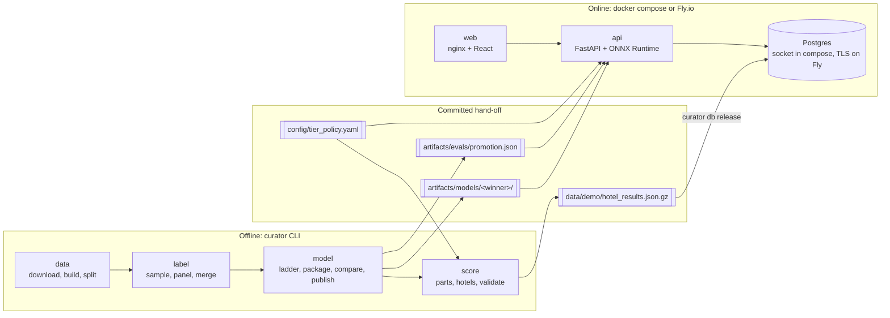
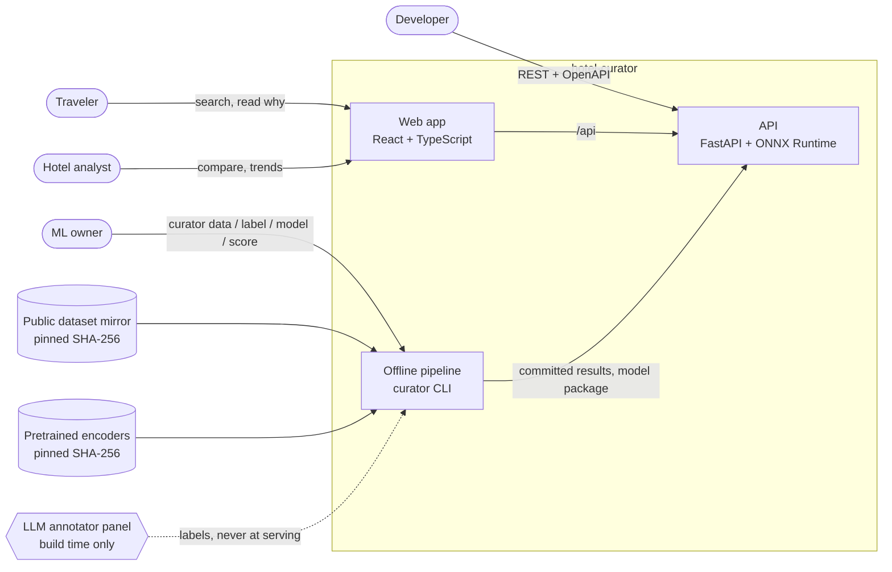
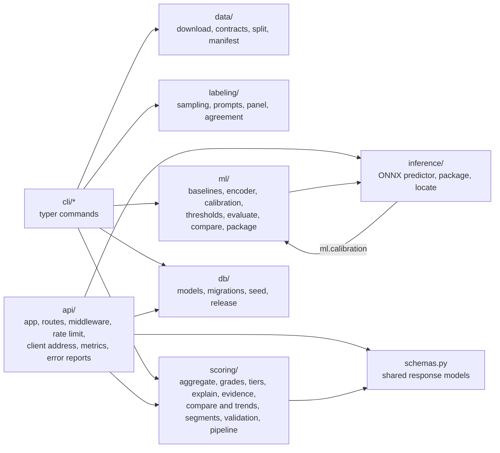

# Architecture

hotel-curator has two halves that meet at a handful of committed files.

- **Offline** ([offline.md](offline.md)): run by hand on a workstation. It
  turns the public review dataset into labels, a model ladder, one promoted
  model package and the results for every hotel. Every stage except the LLM
  annotator panel is a `curator` command; the data, label and scoring stages
  write manifests with the SHA-256 of each output.
- **Online** ([online.md](online.md)): `docker compose up` on a laptop, or
  three Fly.io apps in production. A web app and an API serve the committed
  results and run the promoted model on text a user submits. It never
  trains, never reads the raw dataset and never calls an LLM.

[`index.html`](index.html) draws the main views as standalone diagrams (open
the file in a browser; it needs no network). GitHub renders the Mermaid
blocks on these pages.

## The two halves

## The hand-off

The only coupling between the halves is these files. The API image copies
them at build time (`Dockerfile`); nothing online writes to them.

| File | Written by (offline) | Read by (online) |
|---|---|---|
| `artifacts/evals/promotion.json` | `curator model compare` (the promotion rule, plan section 3.6; it also records the winner's package file hashes) | API start-up, to find the winning package; `GET /v1/meta`, for the evaluation numbers |
| `artifacts/models/<winner>/`: `model.onnx`, `tokenizer.json`, `metadata.json` | `curator model publish`, which copies the files `curator model package` built in `var/packages/<winner>/` and refuses any whose SHA-256 differs from `promotion.json` | API start-up: loaded once; if it is missing, `POST /v1/analyze` answers 503 and every other route works |
| `artifacts/models/<winner>/MODEL_CARD.md` | `curator model report` | not read; documentation |
| `data/demo/hotel_results.json.gz` | `curator score hotels` | `curator db release`: in the API container's entrypoint in compose, as Fly's `release_command` once per deploy; migrates first, then loads unless the file's SHA-256 is already loaded, under a database lock |
| `config/tier_policy.yaml` | by hand (values from ADR 006); read by `curator score hotels` and `validate` | API start-up; `GET /v1/meta` shows every value |

`model.onnx` is stored in Git LFS (`.gitattributes`). A checkout that has
only its LFS pointer (Git LFS not installed, or not pulled) cannot load
it: `/v1/analyze` answers 503; tiers, search, hotel pages and comparison
work from the committed results.

## System context

## Code modules and the half they serve

| Half | Modules |
|---|---|
| Offline only | `data`, `labeling`, and `ml` apart from `ml.calibration` (training needs `make setup-ml`) |
| Online only | `api` |
| Both | `inference` (scoring parts offline, `/v1/analyze` online); `ml.calibration` (numpy only: applies the stored calibration when a package predicts); `scoring` (computes tiers offline; the API uses its value types and the comparison rule); `db` (models and migrations serve the API; `db.seed` writes the results file in `curator score hotels` and loads it in `curator db seed`); `schemas`, `taxonomy`, `text`, `config` |

The API imports no third-party training library (PyTorch, transformers,
scikit-learn, LightGBM, MLflow, spaCy). The API image installs only the core,
`postgres` and `sentry` dependencies, so those libraries are absent from it, and
`test_api_does_not_import_the_training_stack` (`tests/api/test_api.py`)
checks what importing `hotel_curator.api.app` loads in an environment where
they are installed.
