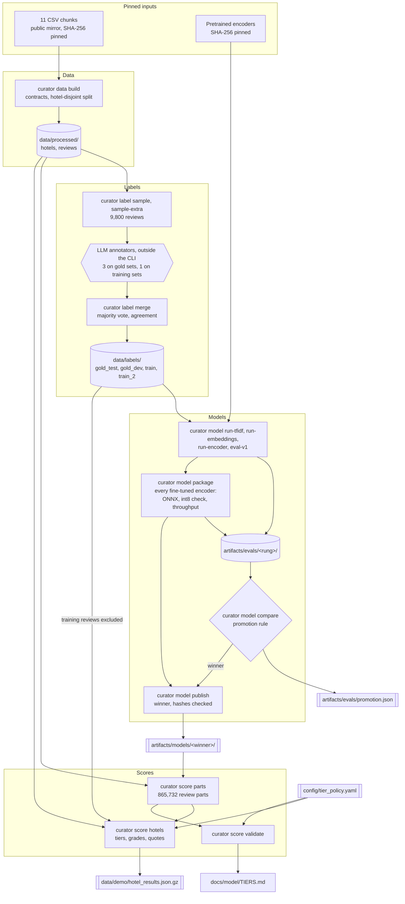
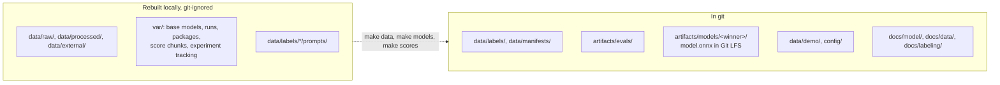

# Offline: from raw reviews to served results

The offline half runs by hand on a workstation (4 CPU cores were enough;
the encoders train for hours). It needs `make setup-ml` for the training
stack. Its job is to produce the committed files the online half reads
([README](README.md#the-hand-off)). Back to the [overview](README.md);
the serving side is in [online.md](online.md).

## Pipeline

Double-bordered boxes are the committed hand-off files; the hexagon is the
LLM annotator panel, the only stage outside the CLI. It is used to make
labels and is never called at serving time (ADR 004).

## Stages

| Stage | Command (Makefile target) | Reads | Writes | Record |
|---|---|---|---|---|
| Data | `curator data build` (`make data`) | 11 CSV chunks, downloaded to `data/raw/` and checked against pinned SHA-256 | `data/processed/hotels.parquet`, `reviews.parquet` (pandera contracts; hotel-disjoint split: train 1,048, val 220, test 226 hotels) | `data/manifests/data.json`: SHA-256 of each input chunk and each output |
| Exploration | `curator data report` (`make eda`) | processed tables | `docs/data/EDA.md` and figures | the report itself |
| Label samples | `curator label sample`, `sample-extra` | processed tables | `data/labels/<set>/sample.parquet`, `index.json`; panel prompts (not committed) | the committed samples |
| Labels | the panel (outside the CLI) answers into `data/labels/<set>/answers/`; then `curator label merge` and `curator label prompts` (`make labels`) | panel answers, the samples, `data/processed/hotels.parquet` | `data/labels/<set>/labels.parquet`, `data/labels/agreement.json`, `docs/labeling/AGREEMENT.md`, the human audit sheet; `prompts` rebuilds and checks the prompt files | `data/manifests/labels.json`: SHA-256 of each output |
| Label checks | `curator label external-prepare`, `external-score`, `audit-score` | a human-labelled external set (TripAdvisor Annotated, pinned) and the panel's answers on it (in git-ignored `data/external/`); a filled audit sheet | `data/labels/external_check.json` (aggregates only) and its report; `data/labels/human_audit_result.json` once the sheet is filled | the reports themselves |
| Base weights | `curator model fetch-base` (`make base-models`) | pinned downloads | `var/models/base/` (not committed) | SHA-256 checked on every download |
| Ladder | `run-tfidf`, `run-embeddings`, `run-encoder`, `eval-v1` (`make baselines embeddings v1-eval encoders train2`) | labels, base weights | `artifacts/evals/<rung>/` (one harness: gold-dev for choices, gold-test for the verdict); encoder checkpoints in `var/runs/<rung>/` (not committed) | each rung's report |
| Package | `curator model package` for every fine-tuned encoder (`make package`) | `var/runs/<rung>/`; the rung's `report.json`, `thresholds.json` and `calibration.json`; gold sets; `data/processed/reviews.parquet` (throughput sample) | `var/packages/<rung>/` (ONNX, fp32 or int8); `artifacts/evals/<rung>/package_report.json`, `package_scores_gold_*.parquet`, `throughput.json` | `files_sha256` in `package_report.json` |
| Promotion | `curator model compare` (`make compare`) | every rung's evaluation and package results, gold-test labels | `artifacts/evals/promotion.json` (with the winner's file hashes), `docs/model/COMPARISON.md` | the rule (plan section 3.6) was committed before any model ran; its clarifications share the M2 commit with the results, so git cannot prove their order |
| Publish | `curator model publish` (`make publish`) | `var/packages/<winner>/`, `promotion.json` | `artifacts/models/<winner>/` (`model.onnx`, `tokenizer.json`, `metadata.json`) | refuses files whose SHA-256 differs from `promotion.json` |
| Model report | `curator model report` (`make model-report`) | `promotion.json`, the winner's evaluation, gold-test labels, the base model's provenance | `docs/model/ERRORS.md`, `artifacts/models/<winner>/MODEL_CARD.md` | the reports themselves |
| Part scores | `curator score parts` (`make score-parts`) | reviews, the promoted package | `data/processed/part_scores.parquet` (chunks in `var/scores/`; not committed) | `data/manifests/scores.json`: the package used and the SHA-256 of the output |
| Hotel results | `curator score hotels` (`make score-hotels`) | processed tables, part scores, the training label sets (their reviews are excluded), tier policy, the promoted package's name | `data/demo/hotel_results.json.gz`, `subset_signals.parquet` | `data/manifests/hotel_results.json`: policy version, package name, SHA-256 of each output |
| Validation | `curator score validate` (`make validate-tiers`) | as for hotel results, plus the winner's gold-dev scores, calibration and gold-dev labels | `docs/model/TIERS.md` (out-of-time check, simulated false-claim rate, stability) | the report itself |

`make models` runs the model targets in order (`... encoders train2 package
compare publish model-report`) and `make scores` the scoring targets.
`curator label sample` and `sample-extra` have no Makefile target: they draw
the samples once, and the drawn samples are committed.

## What is committed and what is rebuilt

Anything large or re-downloadable stays local; anything a reader or the
online half needs is committed, the 126 MB `model.onnx` through Git LFS.

## Reproducibility

- Inputs are pinned by SHA-256: the 11 CSV chunks and every pretrained
  encoder. A mismatch stops the stage.
- Python dependencies are locked in `uv.lock`; the web app's in
  `web/package-lock.json`.
- One seed, from `CURATOR_SEED` (`Settings.seed`), drives the split, the
  samples, training and the bootstrap.
- Every manifest under `data/manifests/` records the SHA-256 of each output;
  `data.json` also records the SHA-256 of each input chunk. The scoring
  manifests (`scores.json`, `hotel_results.json`) name their inputs (model
  package and weights, policy version) but do not hash them; the label
  manifest records no inputs. Each manifest also records the code commit it ran from;
  those ids predate the history rewrite described in `docs/V2_REPORT.md`.
- The package files are tied to the promotion decision by their SHA-256
  (`files_sha256`); `publish` refuses a package that does not match.
- The promotion rule (plan section 3.6) and the tier scheme (ADR 006) were
  committed in the first milestone, before any model ran or any hotel was
  scored; later clarifications and errata are marked as such and say when
  they were written (a milestone, a date, or relative to the first model run
  or the scoring).
