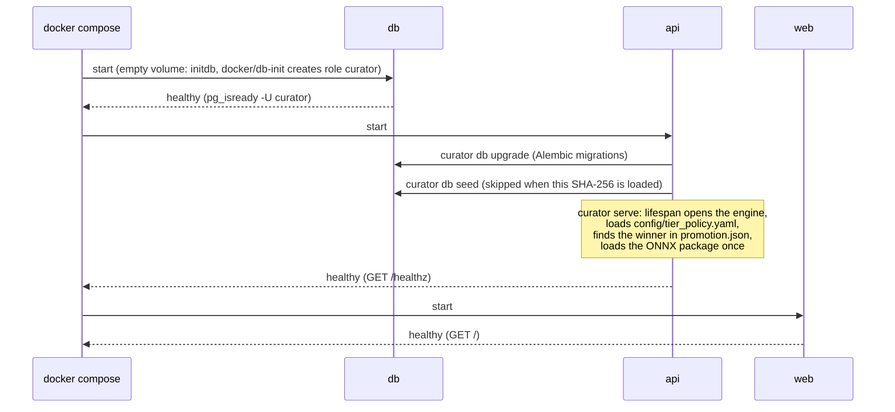
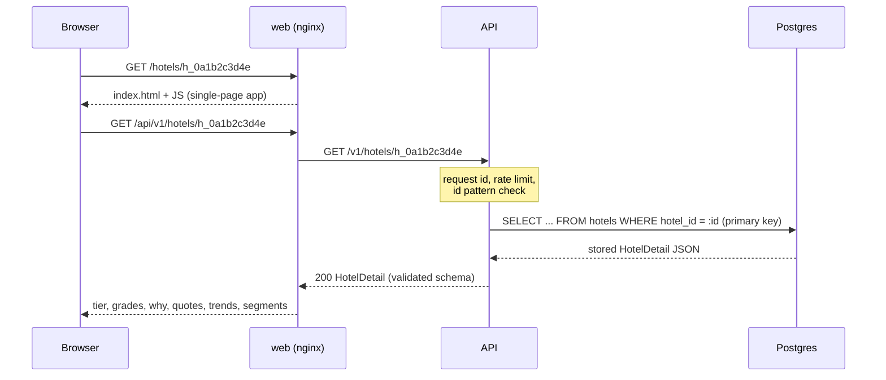
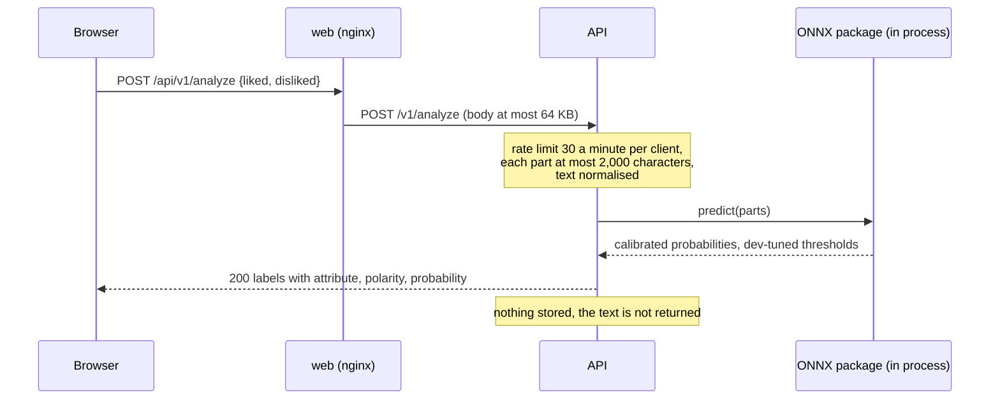
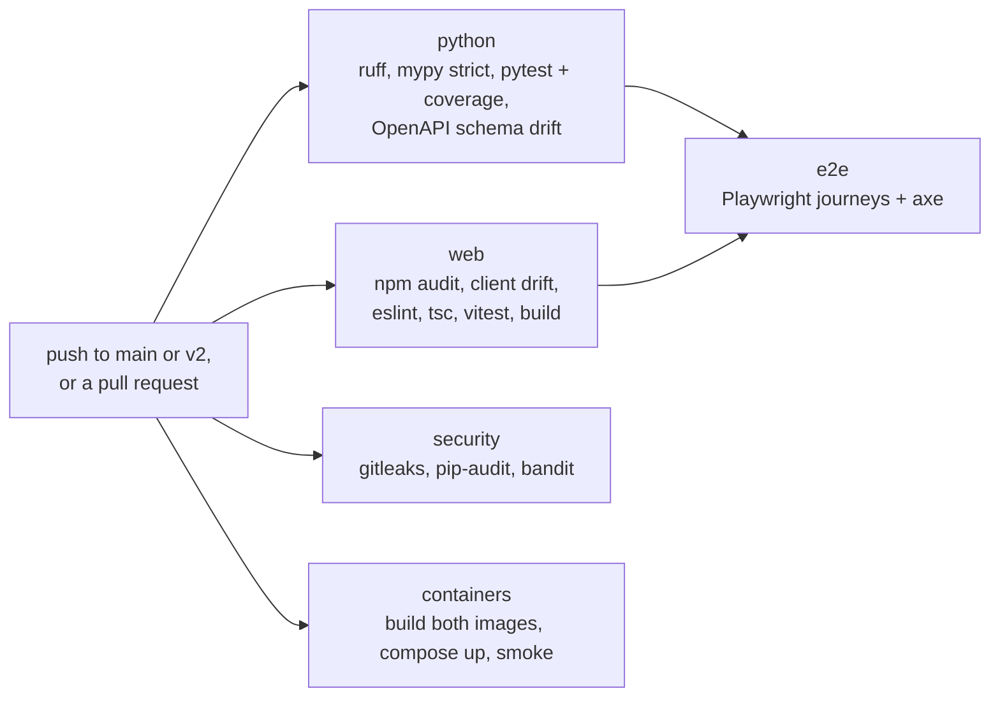

# Online: serving the results

`docker compose up --build` starts three containers. They serve the files
the offline half committed ([README](README.md#the-hand-off)) and never
train, never read the raw dataset and never call an LLM. Back to the
[overview](README.md); how the files are made is in
[offline.md](offline.md).

## Deployment and trust boundaries

| Boundary | What crosses it | Controls |
|---|---|---|
| Browser to web | static app; `/api/*` | ports bound to 127.0.0.1; Content-Security-Policy `default-src 'self'` and no inline script; `X-Frame-Options DENY`, `nosniff`, `Referrer-Policy no-referrer`, `Permissions-Policy`; request bodies over 64 KB refused |
| web to api | proxied `/api/*` requests | nginx overwrites `X-Real-IP` with the client address and blanks `X-Forwarded-For`; the API reads `X-Real-IP` (and nginx's `X-Request-ID`) only from `172.28.0.10` (`CURATOR_FORWARDED_ALLOW_IPS`); request id, CORS allow-list, rate limits per client (120 a minute under `/v1`, 30 a minute on `/v1/analyze`), checked before any body is read; a 64,000-byte body limit (refused on `Content-Length` before reading; a chunked body is cut off once it passes the limit); strict path and query patterns; one error shape |
| api to db | SQL over a Unix socket | the database has no network at all; over the socket the role `curator` connects with trust and the superuser `postgres` only by peer authentication, that is from inside the db container (`docker compose exec -u postgres db psql curator`); `curator` is not a superuser (no `COPY ... PROGRAM`, no server files); bound parameters only |
| Containers to host | volumes; the web and db root filesystems | the API's root filesystem is read-only (tmpfs `/tmp`); web and db have writable root filesystems; `no-new-privileges` on all three; the API (uid 10001) and web (uid 101) run as non-root, and Postgres's entrypoint starts as root and drops to its own user; the API image has no pip and no training libraries |

The role and socket rules come from `docker/db-init/10-app-role.sh`, which
Postgres runs only when it initialises an empty data volume. A `db-data`
volume created by an earlier version of the compose file keeps its old
roles; recreate it with `docker compose down -v`.

Rate limits key on the client address that nginx puts in `X-Real-IP`. In
laptop compose the Docker gateway rewrites client addresses, so every
client on the host shares one bucket. On Fly, nginx takes the address from
`Fly-Client-IP` or, behind Cloudflare, from `CF-Connecting-IP`, so each
client has its own bucket (ADR 011; security review, section 5). Never
publish `:8000` beyond localhost.

## Start-up

If the model package is missing or broken, the reason is logged,
`POST /v1/analyze` answers 503 and every other route works. `GET /readyz`
answers 503 until the database answers and hotel data is loaded; it reports
the model's name but does not require it.

## API surface

| Route | Purpose | Notes |
|---|---|---|
| `GET /healthz` | liveness | used by the container health check |
| `GET /readyz` | readiness | database reachable and hotels loaded |
| `GET /docs`, `GET /openapi.json` | OpenAPI UI and schema | UI assets served by the API itself (`/docs-assets/`), no CDN |
| `GET /v1/hotels` | search | `city`, `tier`, `strong` (Strong in all of these), `avoid_weak` (Weak in none of these), `q` (name contains), `sort`, `page`, `page_size` (up to 100) |
| `GET /v1/hotels/{hotel_id}` | one hotel's tier, grades, reasons, quotes, trends, segments | id must match `h_` and 10 hex digits |
| `GET /v1/compare` | 2 to 4 hotels side by side | |
| `GET /v1/cities` | cities with hotels | |
| `GET /v1/meta` | data, model, evaluation and every tier-policy value | reads `promotion.json` for the evaluation numbers |
| `POST /v1/analyze` | label a review's liked and disliked text with the served model | each part up to 2,000 characters; nothing stored, text not echoed; 503 without the model |

The web app (`/`, `/hotels/:hotelId`, `/compare`, `/about`) calls these
through a client generated from `web/openapi.json`; CI fails if the schema
or the client drifts.

## Request flow: a hotel page

Hotel results are computed offline; the hotel itself is one primary-key
lookup of the stored detail and a schema-validated response. The app shell
also fetches `/v1/meta` and `/v1/cities`.

## Request flow: analyze a review

The only route that runs the model.

Every API error uses one shape, `{"error": {"code", "message",
"request_id"}}`, with `fields` added on validation errors. Errors nginx
generates itself (a body over 64 KB, the API unreachable) are nginx pages.

## How the images are built and checked

CI builds and checks the images; nothing is deployed from it. Base images
and GitHub Actions are pinned by digest or commit SHA.
