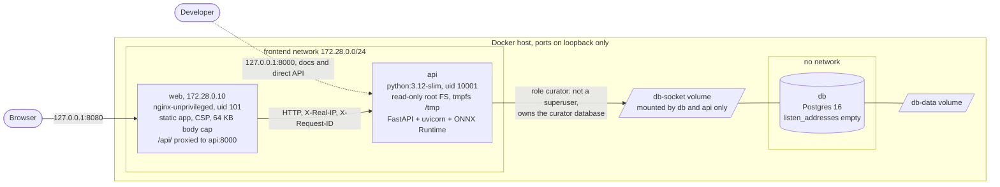
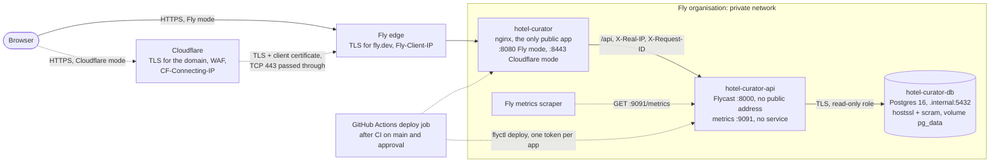
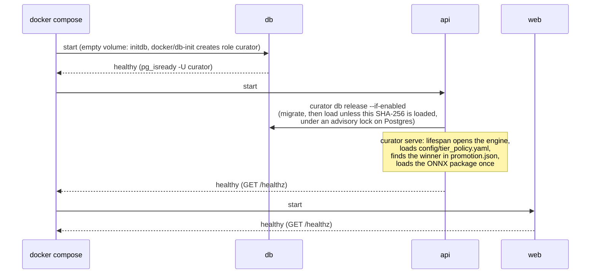
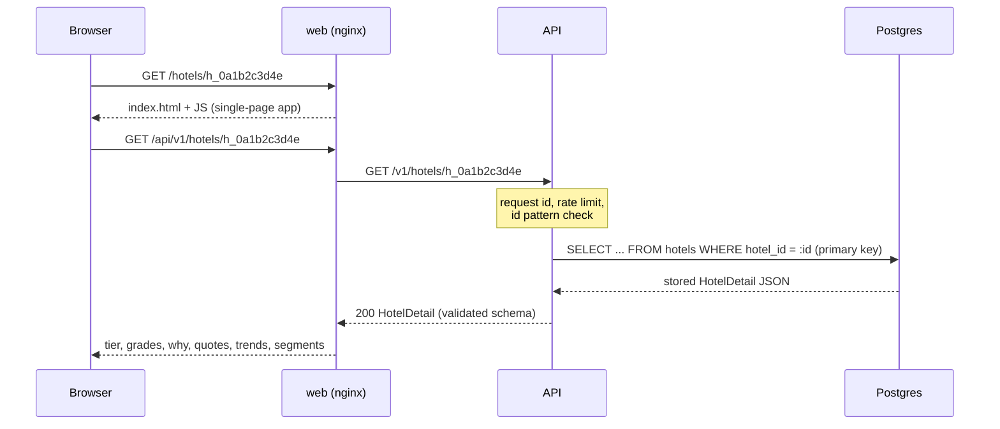
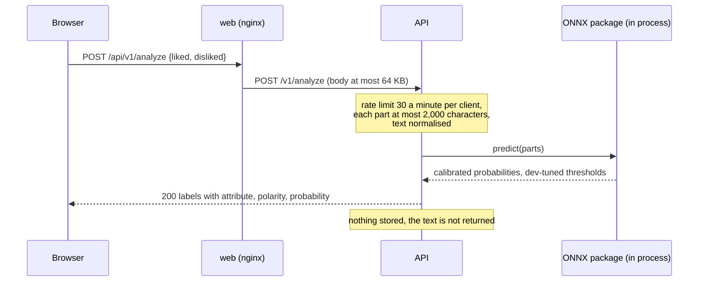
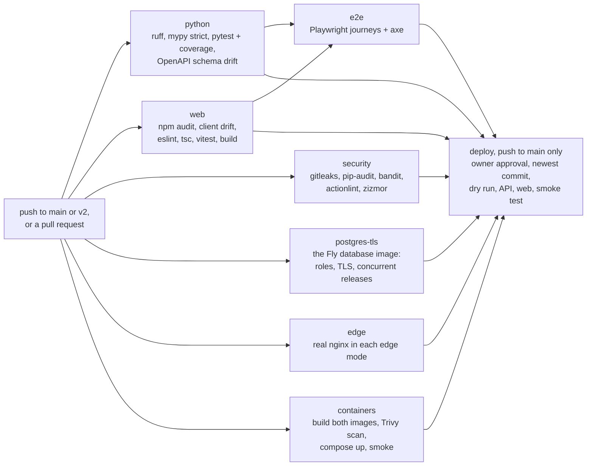

# Online: serving the results

The online half runs the same three images in two places:
`docker compose up --build` on a laptop, and three Fly.io apps in
production ([below](#production-on-flyio)). Both serve the files the
offline half committed ([README](README.md#the-hand-off)) and never train,
never read the raw dataset and never call an LLM. Back to the
[overview](README.md); how the files are made is in
[offline.md](offline.md).

## On a laptop: docker compose

| Boundary | What crosses it | Controls |
|---|---|---|
| Browser to web | static app; `/api/*` | ports bound to 127.0.0.1; Content-Security-Policy `default-src 'self'` and no inline script; `X-Frame-Options DENY`, `nosniff`, `Referrer-Policy no-referrer`, `Permissions-Policy`, `Cross-Origin-Opener-Policy`, one `Strict-Transport-Security` value; request bodies over 64 KB refused |
| web to api | proxied `/api/*` requests | nginx overwrites `X-Real-IP` with the client address and blanks `X-Forwarded-For`; the API reads `X-Real-IP` (and nginx's `X-Request-ID`) only from `172.28.0.10` (`CURATOR_FORWARDED_ALLOW_IPS`); request id, CORS allow-list, rate limits per client (120 a minute under `/v1`, 30 a minute on `/v1/analyze`), checked before any body is read; a 64,000-byte body limit (refused on `Content-Length` before reading; a chunked body is cut off once it passes the limit); strict path and query patterns; one error shape |
| api to db | SQL over a Unix socket | the database has no network at all; over the socket the role `curator` connects with trust and the superuser `postgres` only by peer authentication, that is from inside the db container (`docker compose exec -u postgres db psql curator`); `curator` is not a superuser (no `COPY ... PROGRAM`, no server files); bound parameters only |
| Containers to host | volumes; the web and db root filesystems | the API's root filesystem is read-only (tmpfs `/tmp`); web and db have writable root filesystems; `no-new-privileges` on all three; the API (uid 10001) and web (uid 101) run as non-root, and Postgres's entrypoint starts as root and drops to its own user; the API image has no pip and no training libraries |

The role and socket rules come from `docker/db-init/10-app-role.sh`, which
Postgres runs only when it initialises an empty data volume. A `db-data`
volume created by an earlier version of the compose file keeps its old
roles; recreate it with `docker compose down -v`.

Rate limits key on the client address that nginx puts in `X-Real-IP`. In
laptop compose the Docker gateway rewrites client addresses, so every
client on the host shares one bucket. On Fly, nginx takes the address from
`Fly-Client-IP` or, behind Cloudflare, from `CF-Connecting-IP`, so each
client has its own bucket (ADR 011; security review, section 5). Never
publish `:8000` beyond localhost.

## Production on Fly.io

Three apps in `lhr`, one machine each (ADR 011). Only the web app has
public addresses; the API is reached through Flycast, Fly's private
load-balanced address, and Postgres by its `.internal` name. Before the
Cloudflare cutover visitors reach Fly's edge directly (Fly mode); after it,
Cloudflare terminates their TLS and reaches the origin over TLS with its
client certificate, which Fly passes through as raw TCP (Cloudflare mode).
The drawn version is section 4 of [index.html](index.html#production).

| Boundary | What crosses it | Controls |
|---|---|---|
| Browser to the edge | HTTPS | Fly mode: Fly's certificate for `fly.dev`, `force_https`. Cloudflare mode: Cloudflare's certificate, Full (strict), WAF and a rate rule on `/api/v1/analyze` (dashboard settings, [cloudflare.md](../deploy/cloudflare.md)) |
| Edge to web | Fly mode: HTTP on 8080. Cloudflare mode: TLS on 8443 with the PROXY protocol | Cloudflare mode: Cloudflare's client certificate required (400 without), PROXY source in Cloudflare's committed ranges (403 otherwise), only the domain's names (other SNI refused, other Host 421); 8080 answers only `/healthz` |
| web to API | proxied `/api/*` over Flycast | nginx writes one client address into `X-Real-IP` (`Fly-Client-IP` in Fly mode, `CF-Connecting-IP` in Cloudflare mode) and blanks every other identity header; the API believes `X-Real-IP` from any peer (`*`), because Fly's proxy sits in between, so only apps in the same Fly organisation could choose their own rate-limit bucket. Same request id, body limit and rate limits as in compose |
| API to database | SQL over TLS on the private network | `sslmode=require` (encrypted, server certificate not verified); `hostssl` with scram for exactly two roles: the owner (the release command migrates and seeds) and a read-only serving role; the superuser only by local peer; replication refused; the owner's URL is removed from the server's environment |
| Fly's scraper to the API | `GET /metrics` on 9091 | a listener of its own, no Fly service, bounded labels with no request data |
| GitHub to Fly | deploys | only from CI on `main`, after the owner approves the `production` environment, newest commit only; one app-scoped token per app; flyctl from an image pinned by digest |

Secrets live in Fly (database URLs and passwords, the origin certificate,
an optional Sentry DSN) and in the GitHub environment (deploy tokens),
never in git or images. Fly and Cloudflare behaviours that could not be
checked from the build environment are assumptions A1 to A22 in ADR 011,
each with the check that confirms it at the first deploy. Day-to-day
operation is in the [runbook](../RUNBOOK.md).

## Start-up

In compose:

On Fly, `CURATOR_MIGRATE_ON_START` is off: Fly runs the same
`curator db release` once per deploy as its `release_command`, as the
database's owner role, before the new machines start. The machines then
only serve, as the read-only role, and Fly checks `/readyz` and `/healthz`
every 30 seconds.

If the model package is missing or broken, the reason is logged,
`POST /v1/analyze` answers 503 and every other route works. `GET /readyz`
answers 503 until the database answers and hotel data is loaded; it reports
the model's name but does not require it.

## API surface

| Route | Purpose | Notes |
|---|---|---|
| `GET /healthz` | liveness | the container health check and Fly's liveness check |
| `GET /readyz` | readiness | database reachable and hotels loaded; Fly's service check |
| `GET /docs`, `GET /openapi.json` | OpenAPI UI and schema | UI assets served by the API itself (`/docs-assets/`), no CDN |
| `GET /v1/hotels` | search | `city`, `tier`, `strong` (Strong in all of these), `avoid_weak` (Weak in none of these), `q` (name contains), `sort`, `page`, `page_size` (up to 100) |
| `GET /v1/hotels/{hotel_id}` | one hotel's tier, grades, reasons, quotes, trends, segments | id must match `h_` and 10 hex digits |
| `GET /v1/compare` | 2 to 4 hotels side by side | |
| `GET /v1/cities` | cities with hotels | |
| `GET /v1/meta` | data, model, evaluation and every tier-policy value | reads `promotion.json` for the evaluation numbers; says whether analyze is available |
| `POST /v1/analyze` | label a review's liked and disliked text with the served model | each part up to 2,000 characters; nothing stored, text not echoed; 503 without the model |

Metrics are not an API route: with `CURATOR_METRICS_PORT` set (9091 on
Fly) the API serves Prometheus metrics on a listener of its own, which
nginx never proxies.

The web app (`/` landing page, `/explore`, `/hotels/:hotelId`, `/compare`,
`/about`) calls these through a client generated from `web/openapi.json`;
CI fails if the schema or the client drifts. nginx also serves
`/NOTICE.txt` and `/THIRD-PARTY-NOTICES.txt`, the attribution and licences
the footer links.

## Request flow: a hotel page

Hotel results are computed offline; the hotel itself is one primary-key
lookup of the stored detail and a schema-validated response. The app shell
also fetches `/v1/meta` and `/v1/cities`.

## Request flow: analyze a review

The only route that runs the model.

Every API error uses one shape, `{"error": {"code", "message",
"request_id"}}`, with `fields` added on validation errors. Errors nginx
generates itself (a body over 64 KB, the API unreachable) are nginx pages.

## How the images are built, checked and deployed

A push to `main` that passes every job deploys after the owner approves
it ([fly.md](../deploy/fly.md#deploying-from-github)); pull requests and
other branches only build and check. Base images, tool images and GitHub
Actions are pinned by digest or commit SHA, and Dependabot proposes
updates.
