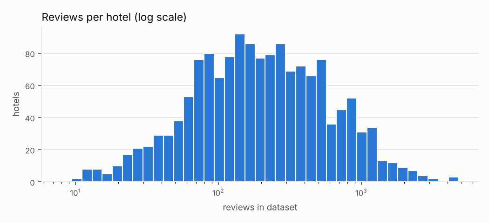
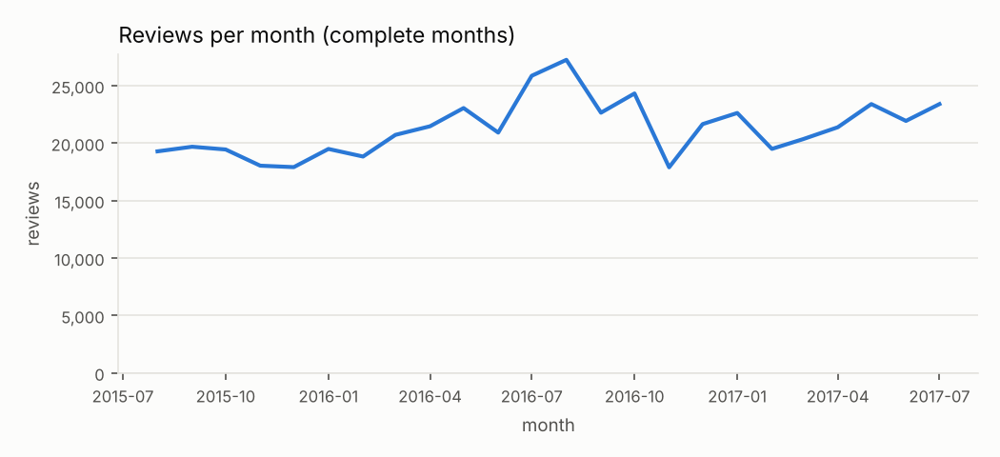
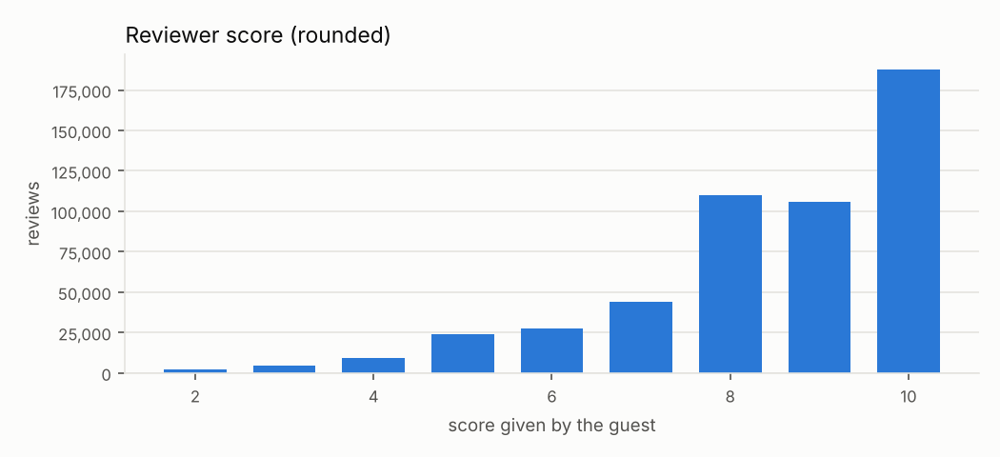
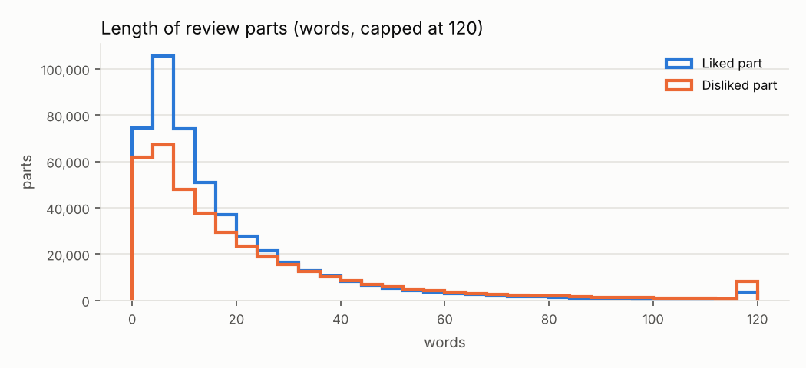

# Exploratory data analysis

_Generated by `curator data report` from `data/processed/`. Do not edit by hand; rerun the command._

## Summary

| Fact | Value |
|---|---|
| Hotels | 1,494 |
| Reviews | 515,212 |
| Cities | Amsterdam, Barcelona, London, Milan, Paris, Vienna |
| Review dates | 2015-08-04 to 2017-08-03 |
| Reviews per hotel (min / median / max) | 8 / 194 / 4,789 |
| Liked part missing (site placeholder) | 7.0% |
| Disliked part missing (site placeholder) | 25.0% |
| Reviews with no text at all | 236 |
| Hotels without coordinates | 17 |
| Mean reviewer score | 8.40 |

Hotels per city and split (hotel-disjoint):

| City | train | val | test |
|---|---:|---:|---:|
| Amsterdam | 74 | 15 | 16 |
| Barcelona | 147 | 33 | 31 |
| London | 281 | 58 | 61 |
| Milan | 114 | 23 | 25 |
| Paris | 322 | 67 | 69 |
| Vienna | 110 | 24 | 24 |

| Traveler type | Share of reviews |
|---|---:|
| couple | 48.9% |
| solo | 21.0% |
| group | 12.7% |
| family_young_children | 11.8% |
| family_older_children | 5.1% |
| friends | 0.4% |

| Trip type | Share of reviews |
|---|---:|
| leisure | 81.0% |
| business | 16.1% |
| unknown | 2.9% |

## Text length

Liked parts: mean 17.6 words, median 11, 95th percentile 56. Disliked parts: mean 23.1, median 13, 95th percentile 77. A 128-token model input covers almost every part.

## Figures

